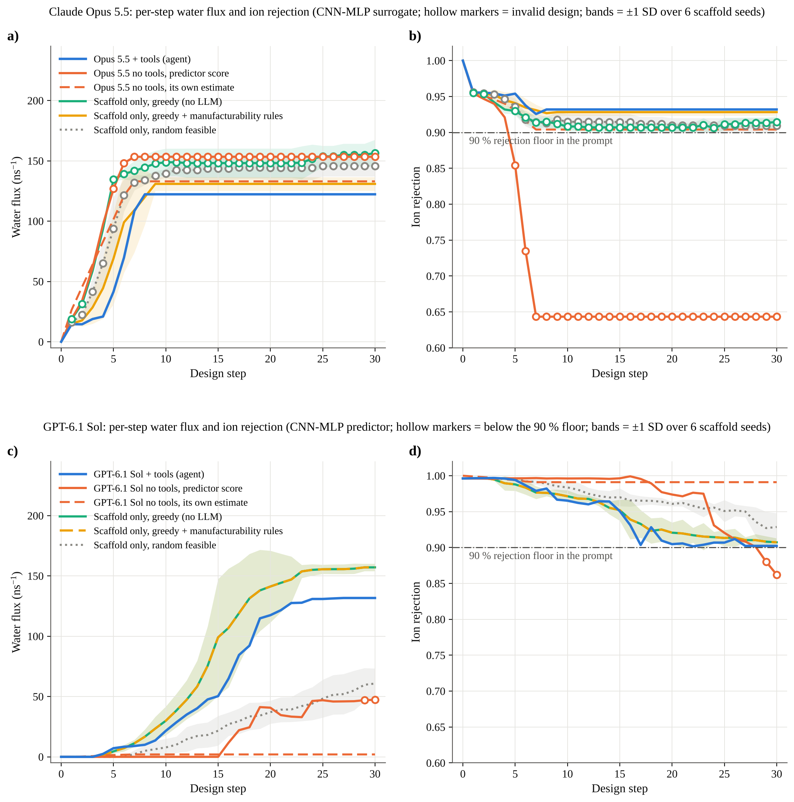
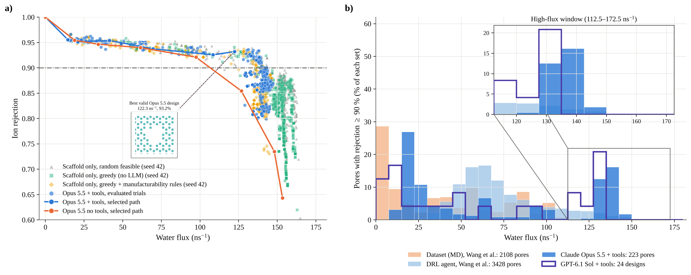

# Desalination LLM

**Large language model agents for the closed-loop design of graphene nanopores for water desalination**

<p align="center">
  
</p>

This repository holds the code, prompts, structures, data and figures for the manuscript **"Desalination LLM: Large Language Model Agents Design Efficient Graphene Membranes for Water Desalination"** by Omid Barati Farimani and Amir Barati Farimani (Carnegie Mellon University).

In this framework an LLM agent grows a pore from the center of a 680-atom graphene sheet. At each step it inspects a set of candidate atom removals, scores them with a pretrained CNN–MLP predictor of water flux and ion rejection (Wang et al., *npj 2D Mater. Appl.* **5**, 66, 2021), and decides which pore to keep. The revised manuscript benchmarks **Claude Opus 5.5** and **GPT-6.1 Sol** under a single protocol. It uses a six-condition ablation to separate the contributions of the language model, the agent scaffold and tool use.

---

## Main results (revised manuscript)

**Protocol:** 30 design steps; up to 30 trials per step; 0–3 atoms removed per trial from the 30 nearest unremoved neighbors, plus colonization of trapped atoms, with at most 3 new atoms per step; 90 % ion-rejection floor.

| Model | Condition | Final flux (ns⁻¹) | Final rejection | Flux relative to rule-constrained scaffold |
|---|---|---:|---:|---:|
| Claude Opus 5.5 | **LLM + tools (agent)** | **122.3** | **93.2 %** | **0.93** |
| | LLM no tools, predictor score | 153.4 | 64.3 % | 1.17 |
| | LLM no tools, own estimate | 133.0 | 90.4 % | – |
| | Scaffold only, greedy † | 156.5 ± 11.1 | 91.5 ± 0.8 % | 1.20 |
| | Scaffold only, greedy + manufacturability rules | 130.9 ± 5.7 | 92.8 ± 0.5 % | 1.00 |
| | Scaffold only, random feasible † | 145.8 ± 8.6 | 90.9 ± 1.0 % | 1.11 |
| GPT-6.1 Sol | **LLM + tools (agent)** | **131.7** | **90.2 %** | **0.84** |
| | LLM no tools, predictor score | 47.3 | 86.2 % | 0.30 |
| | LLM no tools, own estimate | 2.0 | 99.1 % | – |
| | Scaffold only, greedy | 157.1 ± 3.1 | 90.7 ± 0.6 % | 1.00 |
| | Scaffold only, greedy + manufacturability rules | 157.1 ± 3.1 | 90.7 ± 0.6 % | 1.00 |
| | Scaffold only, random feasible | 60.8 ± 12.6 | 92.9 ± 1.9 % | 0.39 |

Scaffold values are mean ± SD over six seeds; LLM conditions are single runs. † The pore splits into several disconnected vacancy clusters at most steps.

- **Tool feedback is decisive.** With the predictor available, both models stayed above the 90 % floor at every step. Without it they failed in opposite directions. Claude Opus 5.5 overestimated rejection by about 22 percentage points and over-etched its pore; GPT-6.1 Sol underestimated flux and barely explored.
- **Much of the performance comes from the scaffold.** A greedy search with explicit manufacturability rules matched or exceeded both agents. Unconstrained searches gained flux only by fragmenting the pore.
- **Compared with earlier work,** 31 % (Claude Opus 5.5) and 25 % (GPT-6.1 Sol) of the agents' high-rejection pores lie at or above 120 ns⁻¹. For the MD dataset this share is 0.2 %, and for the DRL designs of Wang et al. it is 7.2 %. No agent pore exceeds the flux range already present in those sets.

<p align="center">
  
</p>
<p align="center">
  
</p>

**Evaluation route.** Both models use the CNN–MLP predictor of Wang et al. (2021) as the baseline evaluation method. The GPT-6.1 Sol runs queried the frozen ResNet-50/MLP checkpoints directly; every recorded state was re-scored afterwards and agreed within 8 × 10⁻⁵ ns⁻¹. The Claude Opus 5.5 runs queried the geometry surrogate in `models/geometry_surrogate.joblib`, which was trained on 3,000 CNN–MLP predictions (grouped-CV R² = 0.93 for flux and 0.97 for rejection). Because the two routes differ in absolute scale, the models are compared against their own scaffold baselines. For example, the CNN output is clipped at zero flux for the smallest GPT-run pores.

---

## Repository layout

```text
Desalination-LLM/
├── claude_opus/              LLM benchmark: shared environment, tool-using agent, conversation-only
│                             runner, scaffold baselines, CLI tool interface, figure scripts
├── paper_results/            Data behind every figure and table of the revised manuscript
│   ├── claude_opus_5_5/      per-step and per-trial results, decision logs, final structures, t-SNE
│   ├── gpt_6_1_sol/          six-category per-step series and the screened raw GPT-6.1 Sol run (raw/)
│   ├── reference_wang2021/   MD dataset labels and digitized DRL histogram of Wang et al. (2021)
│   └── figures/              final figures (PDF/PNG) and summary tables
├── scripts/                  data preparation, surrogate training, GPT run import
├── src/desalination_llm/     portable Python package: geometry, predictors, optimizer, CLI
├── models/                   geometry surrogate + checksum manifest of the original CNN–MLP checkpoints
├── data/                     pristine graphene structure and archived first-version (Gemini) data
├── prompts/                  user-query and expert prompts
├── configs/                  optimizer configurations
├── figures/, docs/, legacy/  archived figures, data/model notes, original scripts for provenance
└── tests/                    unit and end-to-end tests
```

`paper_results/README.md` maps every file to the figure or table that uses it.

---

## Installation

```bash
git clone https://github.com/OmidMLdata/Desalination-LLM.git
cd Desalination-LLM
python -m venv .venv && source .venv/bin/activate
pip install -e .                 # core package and geometry surrogate
pip install -e '.[torch]'        # optional: original CNN–MLP backend
pip install -e '.[llm]'          # optional: Anthropic / OpenAI clients for the agent runs
```

## Reproducing the manuscript figures

Every figure can be redrawn from the committed data. No model calls or checkpoints are needed.

```bash
CLAUDE_OPUS_RESULTS=paper_results/claude_opus_5_5 \
python -m claude_opus.figures_v3 --out paper_results/figures
```

This writes Figures 3–5, Figures S1–S3, `table_metrics.csv`, `fig4b_stats.csv` and `tableS2_per_step.csv`.

## Rerunning the experiments

```bash
# scaffold-only baselines (no LLM), six seeds
for s in 42 1 2 3 4 5; do for p in greedy constrained random; do
  python -m claude_opus.run_scaffold_baseline --policy $p --seed $s; done; done

# LLM agent with tools and LLM in conversation only (set the API key in your shell; never commit it)
export ANTHROPIC_API_KEY=...
python -m claude_opus.run_tools_agent  --model claude-opus-5-5 --tag opus_tools_api
python -m claude_opus.run_conversation --model claude-opus-5-5 --tag opus_notools_api
```

To use the original CNN–MLP checkpoints instead of the surrogate, place the four `.ckpt` files and `noisy_train.csv` in `models/original_cnn_mlp/`, as listed in `models/original_asset_manifest.csv`, and add `--backend cnn-mlp`. A terminal agent such as Claude Code can drive the same tools through `python -m claude_opus.session_cli`. The two Claude Opus 5.5 runs reported in the paper were made this way, and their full decision logs are in `paper_results/claude_opus_5_5/decision_logs/`.

The GPT-6.1 Sol run (`paper_results/gpt_6_1_sol/raw/`) includes its protocol, frozen input hashes, per-run trial tables, decisions, model prompts and responses, and verification records. See `paper_results/gpt_6_1_sol/raw/REPORT.md`.

---

## First manuscript version (Gemini 2.5 Pro / GPT-5)

The original submission benchmarked Gemini CLI and GPT-5. Its archived data are kept for provenance and can still be reproduced:

```bash
desalination-llm summary                                     # 3,000 trial records, 28 pores in 150–170 ns⁻¹ at ≥ 90 % rejection
desalination-llm reproduce --data data/processed --output figures/reproduced
desalination-llm optimize --config configs/demo.yaml          # runnable optimizer demo
```

Details are in `docs/DATA.md` and `docs/MODELS.md`.

## Scope and limitations

- All flux and rejection values are predictions of the CNN–MLP model or its surrogate. They are not new MD or experimental measurements.
- Each LLM condition was run once. The Claude Opus 5.5 and GPT-6.1 Sol runs used different evaluation routes and agent transports, so cross-model differences are reported relative to each model's own baselines.
- The DRL distribution in Figure 4b was digitized from the published histogram (`claude_opus/digitize_old_fig4b.py`, `claude_opus/calib_fig4b.py`).
- LLM behaviour depends on model version and settings. The model names, prompts, seeds and timestamps are recorded with each run.

## Testing

```bash
pip install -e '.[dev]'
pytest
```

## Citation

Please cite the manuscript and this repository; metadata is in [`CITATION.cff`](CITATION.cff). The MD dataset and CNN–MLP predictor are from:

> Wang, Y.; Cao, Z.; Barati Farimani, A. Efficient water desalination with graphene nanopores obtained using artificial intelligence. *npj 2D Materials and Applications* **2021**, *5*, 66. Data: https://github.com/BaratiLab/Graphene-RL (MIT licence).

## Authors

- **Omid Barati Farimani**, Department of Mechanical Engineering, Carnegie Mellon University, Pittsburgh, PA 15213, USA
- **Amir Barati Farimani** (corresponding author, barati@cmu.edu): Department of Mechanical Engineering; Department of Biomedical Engineering; Department of Chemical Engineering; and Machine Learning Department, Carnegie Mellon University, Pittsburgh, PA 15213, USA

## Acknowledgement

The authors would like to acknowledge the Mechanical and AI Lab at Carnegie Mellon University for computational resources.

## License

See [`LICENSE`](LICENSE).
