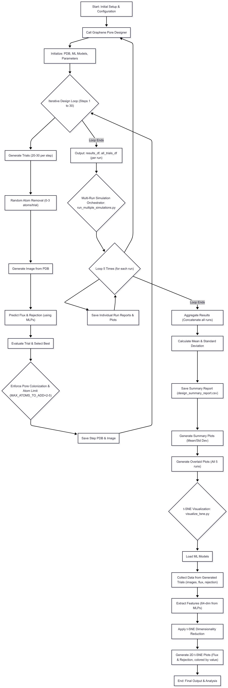
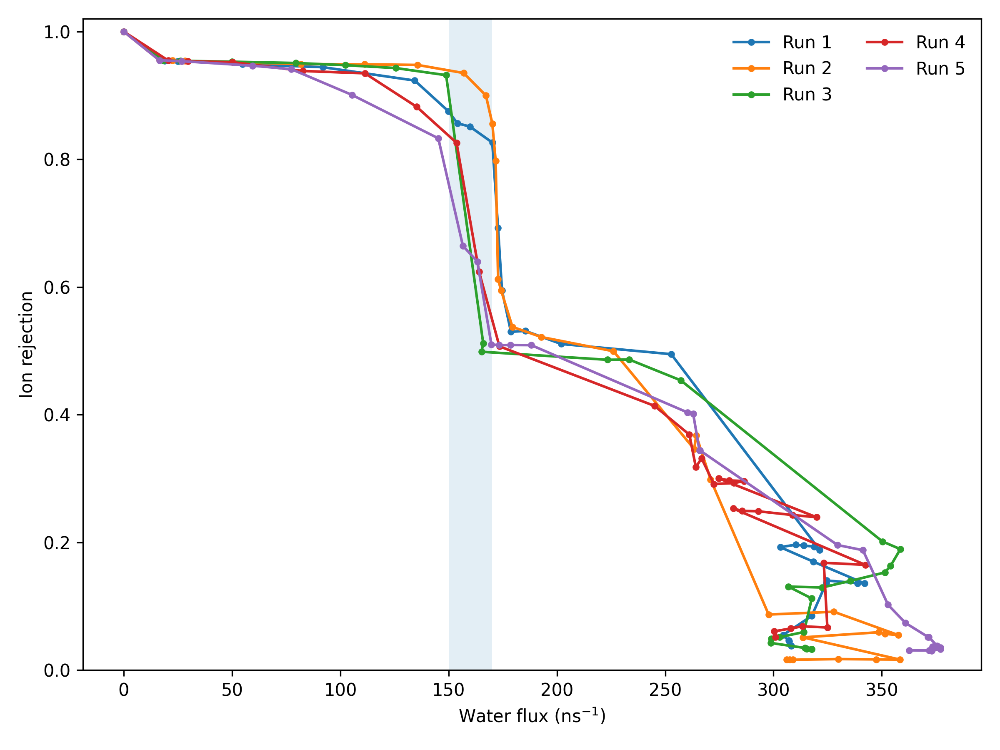
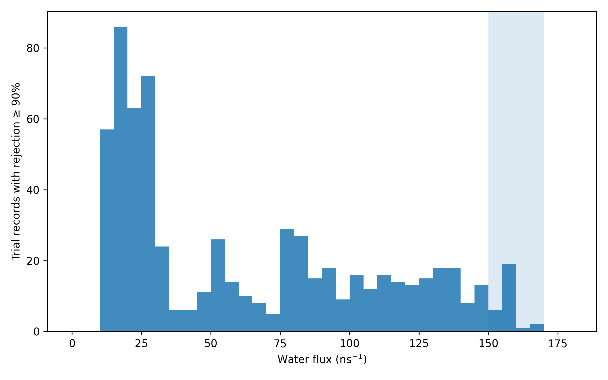

# Desalination LLM

**LLM-guided, closed-loop design of graphene nanopores for water desalination**

<p align="center">
  
</p>

This repository organizes the code, prompts, structures, prediction data, and analysis artifacts associated with the manuscript **“Desalination LLM: Large Language Model Agents Design Efficient Graphene Membranes for Water Desalination.”** The workflow grows a pore from the center of a graphene sheet, evaluates multiple local atom-removal trials, predicts water flux and ion rejection, applies geometry/manufacturability constraints, and repeats the process in a multi-run design loop.

## Repository status

The uploaded project archive was scientifically useful but contained many duplicated scripts, absolute machine paths, and tens of thousands of intermediate PDB/PNG files. This release converts it into a portable Python package with three operating modes:

1. **Paper-data replay — immediately runnable.** Recreate summary figures and inspect the archived trial data without neural-network checkpoints.
2. **Geometry-surrogate optimization — immediately runnable.** Execute the full pore-growth loop using a lightweight surrogate trained from the archived CNN/MLP predictions.
3. **Paper-matched CNN + MLP inference — supported when the original four checkpoints and `noisy_train.csv` are supplied.** Their expected filenames, sizes, and SHA-256 hashes are recorded in `models/original_asset_manifest.csv`.

The included geometry surrogate is provided for software testing and rapid exploration. It is **not** a replacement for the manuscript's primary ResNet50 + residual-MLP models.

## Archived result highlights

The cleaned canonical experiment contains:

- **3,000 trial records** from five runs using 20 trials per step, 30 nearest-neighbor candidates, and up to three removals per trial.
- **28 qualifying trial records** with flux in the `150–170 ns⁻¹` window and ion rejection at or above `90%`.
- **23 unique structures** among those 28 records when structures are deduplicated by removed-atom signature.
- A manuscript-matched design, `run1_step08_trial17`, with predicted flux **159.887 ns⁻¹** and ion rejection **93.398%**.

<p align="center">
  
  
</p>

## Installation

```bash
git clone https://github.com/REPLACE_WITH_OWNER/Desalination-LLM.git
cd Desalination-LLM
python -m venv .venv
source .venv/bin/activate
pip install -e .
```

For the original CNN/MLP backend:

```bash
pip install -e '.[torch]'
```

## Quick start

### 1. Inspect the paper performance window

```bash
desalination-llm summary
```

Expected output includes 3,000 trial records, 28 qualifying records, and 23 unique removed-atom signatures.

### 2. Reproduce the repository figures

```bash
desalination-llm reproduce \
  --data data/processed \
  --output figures/reproduced
```

### 3. Run a functional optimization demo

```bash
desalination-llm optimize --config configs/demo.yaml
```

The run writes stepwise PDB structures, pore images, selected-step data, and trial logs to `results/demo/`.

### 4. Use the paper-matched CNN/MLP models

Copy the original model assets from the local research project:

```bash
desalination-llm import-assets \
  /home/akshay/Documents/MD/test_gemini \
  --destination models/original_cnn_mlp
```

Then run:

```bash
desalination-llm optimize --config configs/paper_cnn_mlp.yaml
```

The exact backend expects:

```text
resnet_smoothl1_all2_flux.ckpt
mlp_smoothl1_all2_flux.ckpt
resnet_smoothl1_all2_rej.ckpt
mlp_smoothl1_all2_rej.ckpt
noisy_train.csv
```

## Method implemented in the active package

At every design step, the optimizer:

1. Ranks unremoved atoms by distance to the current pore boundary, excluding sheet-edge atoms.
2. Samples `0–3` atom removals from the nearest-neighbor pool.
3. Colonizes atoms trapped inside the current convex hull, subject to the per-step atom limit.
4. Predicts water flux and ion rejection.
5. Selects the highest-flux feasible candidate; if none satisfies the rejection threshold, it selects the candidate with the highest rejection.
6. Optionally requests three expert votes—science, geometry, and flux—and accepts the candidate by majority vote.
7. Saves the selected PDB, pore image, geometry descriptors, and machine-readable logs.

The main paper configuration is stored in `configs/paper_cnn_mlp.yaml`.

## Repository layout

```text
Desalination-LLM/
├── configs/                    Reproducible experiment settings
├── data/
│   ├── structures/             Pristine graphene input
│   ├── processed/              Portable trial, trajectory, and ablation tables
│   └── designs/                Selected high-performance PDB/PNG structures
├── docs/                       Data/model/reproducibility documentation
├── figures/                    Archived and reproducible figures
├── legacy/                     Original scripts retained for provenance
├── models/                     Runnable geometry surrogate and asset manifest
├── paper/                      Uploaded manuscript PDF
├── prompts/                    Main and multi-agent prompt templates
├── scripts/                    Data preparation and model-training utilities
├── src/desalination_llm/       Active, portable Python package
└── tests/                      Unit and end-to-end smoke tests
```

## Data provenance

`data/processed/canonical_trials.csv` was reconstructed from the archived directory:

```text
gemini/Trials/geminit20r3k30/
```

Absolute paths in the original CSV files were replaced by portable identifiers. Geometry descriptors and removed-atom serials were reconstructed by comparing each trial PDB with the pristine 680-carbon graphene structure. The 28 structures in `data/designs/high_performance/` correspond exactly to archived trial records satisfying `150 ≤ flux ≤ 170 ns⁻¹` and `rejection ≥ 0.90`.

## Reproducibility and scientific scope

- The archived flux/rejection values are outputs of pretrained predictors, not new molecular-dynamics validation.
- The included geometry surrogate reproduces trends in the archived predictions with five-run grouped cross-validation metrics recorded in `models/geometry_surrogate.metadata.json`.
- Exact CNN/MLP reproduction requires the original checkpoints and training normalization CSV, which were listed in the project manifest but not present in the uploaded `gemini.tar.xz` file.
- LLM decisions depend on model/provider versions and therefore should be logged with model name, prompt version, timestamp, and random seed.
- Before public release, review `LICENSE`, the journal's manuscript-sharing policy, and permissions for the pretrained model checkpoints.

## Testing

```bash
pip install -e '.[dev]'
pytest
```

## Citation

Citation metadata is provided in [`CITATION.cff`](CITATION.cff). Replace the placeholder repository URL and add the publication DOI once available.

## Authors

- Omid Barati Farimani — Department of Mechanical Engineering, Carnegie Mellon University
- Amir Barati Farimani — Department of Mechanical Engineering and Machine Learning Department, Carnegie Mellon University
